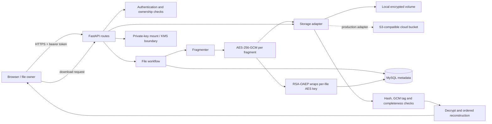

# CryptoSplit architecture and implementation

## What the system does

CryptoSplit accepts a file from an authenticated owner, divides its bytes into ordered fragments, encrypts each fragment, stores ciphertext in a storage service, and later verifies, decrypts, and combines every fragment for an authorized download.

## Request and storage flows

### Upload

1. Authenticate the caller and validate the uploaded size.
2. Generate a random UUID for the file and a fresh 256-bit data-encryption key (DEK).
3. Split bytes into fixed-size ordered fragments.
4. For each fragment, generate a fresh 96-bit nonce and encrypt with AES-GCM. Associated data binds the ciphertext to the file ID, fragment index, and fragment count.
5. Hash ciphertext with SHA-256 for early corruption detection.
6. Wrap the DEK with RSA-OAEP/SHA-256 using the configured public key.
7. Write ciphertext fragments to the chosen storage adapter and commit file/fragment metadata to MySQL. If the database write fails, remove already-written fragments.

### Download

1. Authenticate and query by both file ID and owner ID; missing and foreign-owned IDs both return 404.
2. Fetch ordered fragments and require the stored count to match expected count.
3. Check each object’s expected generated storage key, byte size, and SHA-256 digest.
4. Unwrap the per-file DEK using the private key and decrypt each fragment. AES-GCM verifies its authentication tag and associated data.
5. Concatenate only after every fragment succeeds, check the final length, and return the file.

## Data model

- `users`: UUID, normalized unique email, Argon2 password hash, creation time.
- `files`: UUID, owner, display filename, media type, original length, fragment count, RSA-wrapped DEK, creation time.
- `fragments`: file UUID, zero-based index, generated object key, AES-GCM nonce, ciphertext digest and length.

File bytes and raw DEKs are never put in MySQL. Storage holds only encrypted fragment bytes. The key pair is mounted separately and is never embedded in the image.

## Key choices and threat model

- AES-GCM is an authenticated encryption mode; each fragment has its own fresh nonce under that file's DEK.
- RSA-OAEP protects the small DEK only. It is not used to encrypt file fragments.
- DES is excluded because it is obsolete and provides no meaningful additional protection.
- Fragmentation demonstrates the data-flow architecture; this baseline stores all pieces in one bucket/volume. It does not claim availability or added confidentiality merely from splitting. Multi-provider placement requires an explicit threat model plus redundancy/erasure coding.
- Metadata is sensitive: it reveals ownership, filenames, sizes, and object references. Restrict database access and encrypt/back it up.

## Runtime boundaries

`main.py` is the API composition layer. `security.py` owns password/token logic; `crypto.py` owns cryptographic primitives; `storage.py` hides filesystem/S3 details; SQLAlchemy models describe metadata. The API accepts small demo files with a strict cap. A production large-file flow should stream through a bounded-memory pipeline and use a durable upload state machine/outbox so storage and database failures can be recovered safely.
