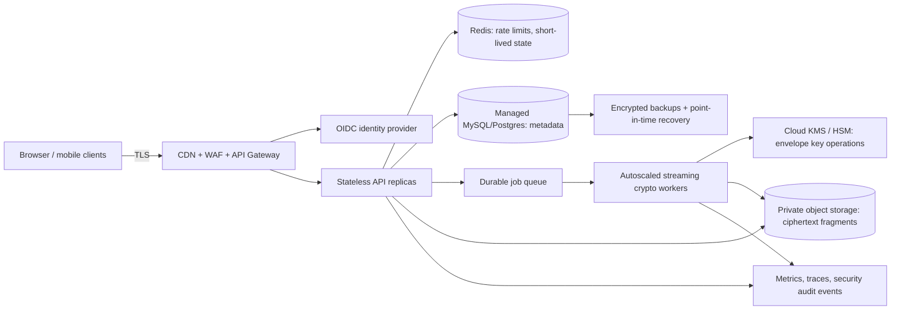

# CryptoSplit: interview walkthrough and scale-up design

## 30-second project description

“CryptoSplit is a secure file-storage service. A user authenticates, uploads a file, and the service fragments it, encrypts every fragment with AES-256-GCM, and stores only ciphertext. The service wraps the file’s random AES key with RSA-OAEP and keeps that wrapped key and fragment metadata in MySQL. On download, it checks ownership, verifies fragment completeness and integrity, unwraps the key, authenticates/decrypts every fragment, and reconstructs the original file. The current build is a working single-node demonstration; the scale-up architecture replaces local components with stateless services, managed cloud storage and KMS.”

## How to walk the interviewer through the diagram

Trace the diagram left to right for upload, then right to left for download:

1. **User and authentication:** The owner signs in. The API validates the bearer token and uses the authenticated owner ID for every file query. Knowing another file’s UUID is not authorization.
2. **Fragmentation:** The server assigns a file UUID and divides the byte stream into ordered chunks. It records original size, total chunks, and each index so it can detect missing or reordered pieces.
3. **Hybrid encryption:** Generate a fresh 256-bit data-encryption key (DEK) for each file. AES-GCM encrypts each chunk with a fresh nonce. Associated data binds a chunk to the file ID, index, and total count. RSA-OAEP/SHA-256 wraps the small DEK; RSA does not encrypt file contents.
4. **Storage:** Only ciphertext is written to the local encrypted-fragment volume or S3-compatible storage. MySQL stores ownership, display metadata, wrapped key, fragment locations, nonces, lengths, and hashes.
5. **Retrieval and verification:** The server first checks ownership, fetches all expected pieces, verifies their expected generated locations, sizes, and hashes, and stops if one is missing or altered.
6. **Decrypt and reconstruct:** The private-key boundary unwraps the DEK. AES-GCM checks authentication tags while decrypting. Only after every piece passes does the server join chunks in index order and return the original file.

## What is implemented now

- Browser registration/login, upload, file listing, download/reconstruction, and delete.
- Argon2 password hashes, short-lived signed bearer tokens, and per-owner access checks.
- Per-file AES-256-GCM key, per-fragment nonce, RSA-OAEP key wrapping, ciphertext digest checks, missing-fragment detection, and final-size validation.
- MySQL metadata, local filesystem storage, and an S3-compatible adapter that can be exercised with MinIO.
- A 50 MiB upload cap and one API instance; the current server buffers uploads in memory.

## High-traffic target architecture

### Scale-up steps

1. **Stream and use multipart objects:** Replace whole-file buffering with a bounded-memory streaming pipeline and multipart object uploads. Keep the HTTP API stateless so it can scale horizontally.
2. **Move processing to workers:** Create an upload record with an idempotency key and states such as `initiated`, `processing`, `stored`, and `failed`. Send work through a durable queue. Workers retry safely and compensate or garbage-collect partial objects.
3. **Use managed object storage:** Store ciphertext fragments in a private S3 bucket. Use object versioning, lifecycle rules, regional replication if required, and least-privilege workload identity. Keep metadata in managed MySQL/PostgreSQL; never store file blobs there.
4. **Upgrade key custody:** Use cloud KMS/HSM envelope encryption. Each file has its own DEK; KMS protects/wraps it under a versioned key-encryption key. Store ciphertext DEK plus key version in metadata. Restrict decrypt permission to the retrieval worker and record key operations in audit logs.
5. **Scale API and guard traffic:** Add an API gateway/WAF, OIDC, Redis-backed rate limits, upload quotas, and autoscaling based on queue depth and CPU. Avoid sticky sessions; use short-lived credentials and idempotent operations.
6. **Operate reliably:** Add metrics for throughput, queue delay, encryption latency, integrity failures, retries, and storage errors. Add encrypted backups, point-in-time database recovery, alerts, and restore drills.
7. **Choose multi-region or fragmentation placement from a threat model:** Splitting alone does not provide redundancy. To survive provider/region loss, use replication or erasure coding and test recovery. Do not add more encryption algorithms as a substitute.

### Encryption upgrade explanation

The secure next step is **envelope encryption with managed key custody**, not stacking AES, DES, and RSA. Keep AES-GCM for file bytes; keep a different random DEK per file; use KMS to wrap and version DEKs; rotate the KMS wrapping key by rewrapping DEKs without re-encrypting every file. If the requirement is that even the service operator cannot decrypt files, move encryption into the client (browser/mobile) and design user-controlled recovery and sharing keys. That is a different threat model and can make account recovery impossible if the user loses their key.

## Likely interview questions

**Why fragment if you already encrypt?**  Fragmentation supports chunked processing, parallel transfer, and recovery/placement strategies. It is not the confidentiality control; authenticated encryption is.

**Why not encrypt each chunk with RSA or use three algorithms in sequence?**  Public-key crypto is inefficient for bulk data and RSA has strict message-size limits. AES-GCM is designed for bulk authenticated encryption; RSA-OAEP/KMS protects only the small AES key. DES is obsolete.

**What happens if a fragment is changed or missing?**  The API checks the expected count and digest; AES-GCM then authenticates each fragment and its bound metadata. It returns an error and never silently returns a partial reconstruction.

**How does it scale?**  Stateless API replicas handle auth/metadata; streaming workers scale independently for CPU-heavy encryption; object storage scales file bytes; the relational database contains only metadata; Redis and a durable queue handle shared throttling and asynchronous work. Queue depth and latency guide autoscaling.

**Is this production-ready?**  The code is an academic working baseline. The target architecture needs streaming, a durable queue/state machine, KMS, OIDC, distributed rate limits, migrations, monitoring, backup/restore, and a security review before production.

## Detailed backend walkthrough (5 MiB example)

Assume the configured chunk size is 1 MiB. A 5 MiB file becomes five ordered pieces: `F0` through `F4`. The final piece can be shorter if the file size is not an exact multiple of the chunk size.

### What happens during upload

1. **Receive and authorize:** Browser sends the file over HTTPS with its short-lived login token. The API validates the token and upload-size limit. The demo associates a file with a company when its owner shares it to an organization; a production version should support explicit folders and upload destinations.
2. **Assign an ID and split:** The service creates a random file UUID. It splits the file byte stream into fixed-size chunks, numbers them, and records the original size and chunk count. The current small-file demo reads the bounded upload into memory; a high-volume version streams chunks without keeping the whole file in RAM.
3. **Create the data key:** The service generates 32 random bytes as a new AES-256 data-encryption key (DEK) for this file. A different file gets a different DEK.
4. **Encrypt each piece:** For each chunk, generate a new 12-byte nonce and call AES-GCM. The input is the chunk bytes; associated data includes the file UUID, chunk number, and total chunk count. AES-GCM returns ciphertext plus an authentication tag. The tag lets decryption detect changed ciphertext, wrong key, wrong nonce, or altered associated data. A nonce is never reused with the same DEK.
5. **Protect the DEK:** Encrypt the small DEK with RSA-OAEP/SHA-256 using the public key, or in the scale-up design ask KMS to generate/wrap a data key. Store only the wrapped/encrypted DEK. The private RSA key or KMS decrypt permission stays in a protected service boundary.
6. **Write data and metadata:** Write each ciphertext object under an opaque generated key such as `file-uuid/00000000.bin`. MySQL stores file owner/company, safe display metadata, original byte size, chunk count, wrapped DEK, and for each chunk its order, nonce, ciphertext length, hash, and object key. Never store plaintext file bytes or the unwrapped DEK in the database. The current app writes to local disk by default; its optional S3-compatible adapter can use MinIO.
7. **Finish safely:** Mark the upload complete only after all chunks and metadata are committed. If a write fails, delete partial objects or leave a recoverable failed-upload record for cleanup. A production pipeline uses idempotency keys and a durable upload state machine because SQL and object storage do not share one transaction.

### What happens during download

1. The browser requests a file ID with its login token.
2. The API finds the file and checks that this exact user is the owner or has a current, explicit grant. It performs this check on every download, not just when rendering the file list.
3. The service fetches all expected ciphertext chunks, checks that none is missing, checks each object key/length/hash, and loads the wrapped DEK.
4. The protected key service unwraps the DEK. The service decrypts every chunk in index order. AES-GCM verifies each authentication tag and the associated file/chunk metadata.
5. Only when all chunks pass does the service join them, compare the reconstructed length with the original size, and stream the original file back over HTTPS. If any chunk is missing, altered, or fails authentication, it returns an error instead of a partial or corrupted download.

A plain SHA-256 hash is a quick corruption check; it is not a substitute for AES-GCM authentication because an attacker who can change both a chunk and the database hash could replace both. The GCM tag is the cryptographic integrity check.

## Sending/sharing a file with another person

The demo now supports organization workspaces, member roles, and explicit download shares. Users register with a unique username, an organization admin adds existing users by username, and an owner or organization admin shares an uploaded file with an active member's username. The API checks the signed-in account, membership, grant status, and optional expiration every time the recipient downloads. A username or file UUID alone does not grant access, and the RSA private key is never sent to the recipient.

The implemented permission flow is:

1. The file owner or an organization admin chooses **Share**, selects a colleague by account username, and grants `download` permission (the API supports optional expiry).
2. The API verifies the caller may share that file and that the recipient is an active member of the same organization.
3. Store a grant in `file_shares`: `file_id`, `grantee_user_id` (or group ID), permission, `granted_by`, `created_at`, `expires_at`, and `revoked_at`.
4. The recipient signs in, opens **Shared with me**, and requests download. The API checks the grant again, fetches ciphertext, unwraps/decrypts on the server, and returns the reconstructed file. The recipient gets the file through the app; no AES key is sent in email or chat.
5. The owner/admin can revoke the grant. That blocks future access. It cannot erase a copy the recipient already downloaded, so audit downloads and use short-lived sessions/links where appropriate.

For an email share-link instead of a registered user, generate a high-entropy random token, store only its hash, bind it to one file and permission, set a short expiry, and let the owner revoke it. Require the intended recipient to authenticate or verify their email. Never put the AES key, RSA private key, JWT, or a permanent public bucket URL in the share link.

### Company database changes

- `organizations(id, name, created_by, created_at)`
- `organization_memberships(organization_id, user_id, role, status)` with a unique `(organization_id, user_id)`
- Extend `files` with nullable `organization_id`; retain `owner_id` for accountability
- `file_shares(id, file_id, grantee_user_id, permission, granted_by, expires_at, revoked_at)`
- `audit_events(actor_user_id, org_id, file_id, action, timestamp, outcome)`

Organization membership is scoped by organization and role. Ordinary members see files they own plus files explicitly shared with them; only owners, grantors, and organization admins can revoke a share. Production list/search routes should apply the same permission filters as download and add audit logging, invitation/approval flows, and richer policies.

### Security choices to explain

- **AES-GCM** handles large file data and authenticates it. A fresh nonce per chunk under a file key is required. The file ID/index/count as associated data makes chunk swapping or relabeling fail authentication. [PyCA AES-GCM API](https://cryptography.io/en/stable/hazmat/primitives/aead/)
- **RSA-OAEP or KMS** protects only the small AES key. Do not run AES, DES, and RSA over every fragment in sequence. DES is obsolete and adds no useful protection.
- **Server-side decryption** is the current design: after an authorization check, the trusted backend decrypts and returns the file. It means the service operator can access plaintext.
- **End-to-end encryption** is a different design: encrypt in the user's browser/device and wrap the DEK to each recipient's public key. The server cannot decrypt, but account recovery, sharing, and lost-key recovery become harder.
- **Object-store links:** A presigned S3 URL is a temporary bearer capability to an object. In this system it must only expose ciphertext and be short-lived; normal company sharing should go through the API's authorization check. [S3 presigned URL guidance](https://docs.aws.amazon.com/AmazonS3/latest/userguide/using-presigned-url.html)

## Short interview answer

“On upload, we authenticate the user, split the file into ordered chunks, encrypt each chunk with AES-GCM using a unique nonce and file/chunk associated data, and store only ciphertext. We wrap the random per-file AES key with RSA-OAEP and store that wrapped key with the file and chunk metadata. To share, a user with permission grants download access to an active member in their organization; we record the grant and optional expiry. On download, the API checks both the grant and current organization membership, retrieves and verifies every chunk, unwraps the key, lets AES-GCM authenticate/decrypt the chunks, then reconstructs and returns the file. The user downloads through the application, so we do not send the RSA private key to them.”
